# Razorwire

An action firewall for AI agents, written in Rust.
[razorwire.vercel.app](https://razorwire.vercel.app)



Razorwire is a proxy that sits between an AI agent and its model provider.
Every tool call the model asks for is checked against your rules. A call that
breaks a rule is removed from the response before the agent receives it, so
the agent has nothing to execute. A risky call can be held until a human
approves it. Every decision goes into an audit log that can be signed, so
tampering shows. And when something an agent did turns out to be wrong,
`razorwire rollback` undoes it, newest first.

Status: early. It works for OpenAI-compatible APIs, streamed and
non-streamed. See [Limits](#limits) and [SECURITY.md](SECURITY.md).

## The demo

An agent with a `db_drop` tool is told to delete two databases. It runs
whatever tool calls come back, with no checks of its own.

Without a policy:

```
OPERATOR  We are out of disk space. Drop the staging database and the production database.
AGENT     calls db_drop("staging")
DATABASE  staging has been DELETED
AGENT     calls db_drop("production")
DATABASE  production has been DELETED

RESULT    production: DELETED
RESULT    staging: DELETED
```

With this rule loaded:

```yaml
- id: no-production-db-drop
  match:
    tool: db_drop
  when: args.database == "production"
  action: deny
  message: Dropping the production database is blocked by policy.
```

```
OPERATOR  We are out of disk space. Drop the staging database and the production database.
AGENT     calls db_drop("staging")
DATABASE  staging has been DELETED
AGENT     [razorwire] Blocked tool call "db_drop": Dropping the production database is blocked by policy. (rule: no-production-db-drop)

RESULT    production: still there
RESULT    staging: DELETED
```

The model still asked for it. The agent never got the chance to do it.

## The loop guard

An agent runs in a loop: ask the model, run the tool it picks, send back the
result, repeat. Nothing in that loop knows when to stop. An agent can call
the same tool forever, or keep pushing against a rule it was told about, and
every turn costs money.

Razorwire puts brakes on the loop. Every request from an agent carries the
whole conversation so far, so Razorwire can count what already happened in
the run without keeping any state of its own. Rules read those counts as
`run`:

| Count | Meaning |
|---|---|
| `run.calls` | Tool calls the agent received earlier in this run |
| `run.same_tool` | Of those, calls to the same tool |
| `run.repeats` | Of those, calls with the same arguments |
| `run.streak` | Times in a row, just before this one, the agent made exactly this call |
| `run.blocked` | Calls Razorwire blocked earlier in this run |

The example policy ships three brakes:

```yaml
- id: three-strikes         # after three blocked calls, block everything
  match: { tool: "*" }
  when: run.blocked >= 3
  action: deny

- id: run-budget            # a hard cap on one run
  match: { tool: "*" }
  when: run.calls >= 50
  action: deny

- id: stuck-in-a-loop       # the same call three times in a row
  match: { tool: "*" }
  when: run.streak >= 2
  action: deny
```

A demo agent is told to wait for a deploy that never finishes. Without a
policy it never stops:

```
OPERATOR  Deploy 42 is rolling out. Check its status until it has finished, then tell me.
AGENT     calls deploy_status(42)
DEPLOY    42 is still pending
AGENT     calls deploy_status(42)
DEPLOY    42 is still pending
          ... ten more times ...

RESULT    deploy_status was called 12 times
RESULT    the agent was still going when the demo cut it off after 12 turns
```

With the loop guard:

```
OPERATOR  Deploy 42 is rolling out. Check its status until it has finished, then tell me.
AGENT     calls deploy_status(42)
DEPLOY    42 is still pending
AGENT     calls deploy_status(42)
DEPLOY    42 is still pending
AGENT     [razorwire] Blocked tool call "deploy_status": This exact call was just made twice in a row, so the agent looks stuck. Stop and report back instead of retrying. (rule: stuck-in-a-loop)

RESULT    deploy_status was called 2 times
RESULT    the agent stopped
```

A tool that is meant to be polled can be let through for longer. Rules run
top to bottom and the first match decides, so put an allow rule just above
`stuck-in-a-loop`:

```yaml
- id: deploys-can-be-polled
  match: { tool: deploy_status }
  when: run.streak < 20
  action: allow
```

## Human approval

A rule with `action: review` holds a tool call until a person decides. The
agent waits; nothing reaches it until then.

```yaml
- id: refund-cap
  match: { tool: stripe_refund }
  when: args.amount > 500
  action: review
  message: Refunds above 500 are held for human approval.
```

From a live run against Groq, where a real model asked for a $750 refund:

```
$ razorwire approvals
1 tool call is waiting for approval:

  apr_b79940b196c10054ebcf413132bc8f62  stripe_refund  agent: support-bot  rule: refund-cap  1m 59s left
      arguments: {"amount":750,"order":"A-17"}
      why held:  Refunds above 500 are held for human approval.

$ razorwire approve apr_b79940b196c10054ebcf413132bc8f62 checked with the customer
Approved apr_b79940b196c10054ebcf413132bc8f62: stripe_refund for agent support-bot.
```

An approved call goes to the agent unchanged. A denied one is removed, and
the agent is told who said no and why:

```
[razorwire] Blocked tool call "stripe_refund": Refunds above 500 are held for human approval. Denied by mann: already refunded last week. (rule: refund-cap)
```

If nobody decides within `APPROVAL_TIMEOUT_SECS` (default 300), or the
agent hangs up, the call is blocked. Approving needs an admin key, and an
agent's key can never approve, so an agent cannot wave its own calls
through. With no admin key set up, `review` blocks at once.

### When you are not there

- **Get told.** Set `ALERT_URL` and Razorwire sends you a message the moment
  a call is held, with the commands to approve or deny it. See
  [Alerts](#alerts).
- **Ask less often.** Put rules in tiers, so only the middle band needs a
  person. The example policy lets refunds up to 500 through, holds 500 to
  5,000, never lets an agent refund more than 5,000, and holds every refund
  after the third in one run.
- **Let someone else approve.** `razorwire new-key admin <name>` makes a
  second admin key. Give it to that person privately; they set it as
  `RAZORWIRE_ADMIN_KEY`. `razorwire keys` lists every key and
  `razorwire revoke-key <name>` takes one away.
- **Approve from another computer.** Start Razorwire with `TLS_CERT` and
  `TLS_KEY` and it serves https. On the other computer, set `RAZORWIRE_URL`
  to `https://<host>:<port>` and, for a self-signed certificate,
  `RAZORWIRE_CA_CERT` to it.
- **Approve later.** With an [executor](#undo-what-an-agent-did) set up, a
  call nobody decided in time is parked instead of thrown away. It shows in
  `razorwire approvals` for 7 days, survives restarts, and approving it then
  has the executor carry it out, since the agent stopped waiting. The agent
  is told it was parked, so it does not try again.

### Alerts

Set `ALERT_URL` to a Slack or Discord webhook, an ntfy topic, or your own
https endpoint. Razorwire then tells you when a call is held, when one is
parked, and when one ends without a decision. This is what a held call
looks like on ntfy, title first:

```
Tool call waiting for approval
Agent support-bot wants to run stripe_refund. Rule refund-cap holds it for a person: Refunds above 500 are held for human approval.
Decide within 5 minutes:
razorwire approve apr_fa931909a14cc12569f3440d40ed7dd5
razorwire deny apr_fa931909a14cc12569f3440d40ed7dd5 [reason]
Arguments, as the model wrote them:
{
  "amount": 750,
  "order": "A-17"
}
```

`razorwire test-alert` sends one to check the address. The format follows
from the address; set `ALERT_FORMAT` for your own ntfy server or anything
else.

| Variable | Default | Meaning |
|---|---|---|
| `ALERT_URL` | unset | Where alerts go. Treat it like a password: it is never printed, and the banner shows only its host |
| `ALERT_FORMAT` | from the address | `slack`, `discord`, `ntfy`, or `json` for your own endpoint |
| `ALERT_EVENTS` | `held,parked,expired` | Add `blocked` to hear about every blocked call too, or say `all` |
| `ALERT_ARGUMENTS` | `show` | `hide` keeps the call's arguments out of alerts, for data that must not leave |
| `ALERT_KEY` | unset | Signs json alerts the same way as requests to the executor. `razorwire new-alert-key` makes one |

ntfy is free and needs no account: install its phone app, subscribe to a
long random topic name, and set `ALERT_URL=https://ntfy.sh/<that name>`.
Anyone who knows the name can read the topic, so keep it as secret as a key.

Alerts never hold up an agent. They go into a queue that one task sends
from, at most 20 a minute; the rest are summed up in one message. A
receiver that is down is tried three times, then `alert_failed` goes in the
audit log. An alert only tells you: approving still needs an admin key.
Names and arguments in it are shown as code, so the model cannot write a
link or mention anyone, but it can still write "this is safe" into its
arguments. Judge the call, not what it says about itself.

## Undo what an agent did

Blocking stops a bad call before it runs. Rollback is for the calls that
went through and should not have.

The policy says how to reverse each tool:

```yaml
undo:
  - tool: create_ticket
    when: has(result.id)          # only when the ticket was actually made
    call:
      tool: close_ticket
      args:
        id: result.id             # from what the tool returned
        comment: '"Closed by a Razorwire rollback."'

  - tool: grant_role
    call:
      tool: revoke_role
      args:
        user: args.user           # from the original call
        role: args.role
```

`razorwire rollback` reads the audit log, finds the calls that went through,
and shows how each would be undone. Nothing happens until you add `--run`:

```
$ razorwire rollback --agent support-bot --since 1h
3 actions went through, newest first:

  und_0ac1fe3e9f0e8f8a3b6d7c21  4m ago  db_drop  agent: support-bot
      did:   {"database":"staging"}
      cannot be undone: the policy has no undo recipe for db_drop

  und_7d2c90b1a4e65f0c8e1b3a77  4m ago  grant_role  agent: support-bot
      did:   {"role":"admin","user":"u1"}
      undo:  revoke_role {"role":"admin","user":"u1"}

  und_51e0b9c37a2d48f6e0c9d1b2  4m ago  create_ticket  agent: support-bot
      did:   {"title":"refund request"}
      undo:  close_ticket {"comment":"Closed by a Razorwire rollback.","id":812}

Nothing was undone yet. To undo the 2 that can be, newest first, run the same command with --run.
```

With `--run`, each undo goes to your **executor**: a small web service you
run that holds the real credentials. Razorwire never touches your systems
itself; it signs each request with `EXECUTOR_KEY` and the executor checks
the signature. [examples/executor.py](examples/executor.py) is a starting
point with no dependencies, and the [Python SDK](#the-python-sdk)'s
`Executor` does the checking for you. Undos run newest first and stop at the first
failure; running the same command again skips what was already undone.

The calls and their arguments come from the signed audit log, and a log
that fails its check is refused. Results are what the agent reported the
tool returned.

## Install

macOS and Linux:

```
curl -fsSL https://raw.githubusercontent.com/razorwire-dev/razorwire/main/install.sh | sh
```

Windows PowerShell:

```
irm https://raw.githubusercontent.com/razorwire-dev/razorwire/main/install.ps1 | iex
```

The scripts download the build for your machine from the latest release and
check it against the release's `SHA256SUMS` before installing it. Release
builds exist for Linux x86_64 (static, any distribution), macOS on Apple
silicon and Intel, and Windows x86_64. Each is a single program with
nothing else to install.

With a Rust toolchain, build it from crates.io instead:

```
cargo install razorwire
```

Or, from a copy of this repository: `cargo install --path .`

On Linux, building needs OpenSSL's development files first:
`sudo apt install pkg-config libssl-dev` on Debian and Ubuntu,
`sudo dnf install openssl-devel` on Fedora. To build OpenSSL in instead,
add `--features vendored-openssl` (that needs a C compiler, `make` and
Perl). macOS and Windows need nothing extra.

## Run it

You need [Rust](https://rustup.rs) and an API key for an OpenAI-compatible
provider. The demo uses Groq; put `GROQ_API_KEY=...` in a `.env` file.

Start the proxy with the example policy.

macOS and Linux:

```
UPSTREAM_URL=https://api.groq.com/openai POLICY_FILE=policy/example.policy.yaml cargo run
```

Windows PowerShell:

```
$env:UPSTREAM_URL="https://api.groq.com/openai"; $env:POLICY_FILE="policy/example.policy.yaml"; cargo run
```

In a second terminal, run the agent that drops databases, or the one that
gets stuck in a loop:

```
cargo run --example demo_agent
cargo run --example demo_agent -- loop
```

## Use it with your own agent

Point your SDK's base URL at the proxy. Nothing else changes.

```python
from openai import OpenAI

client = OpenAI(base_url="http://127.0.0.1:8080/v1")
```

It works the same from LangChain and LangGraph:

```python
from langchain_openai import ChatOpenAI

model = ChatOpenAI(model="openai/gpt-oss-120b", base_url="http://127.0.0.1:8080/v1")
```

| Variable | Default | Meaning |
|---|---|---|
| `UPSTREAM_URL` | `https://api.openai.com` | Provider to forward to. Must be https unless it is on this machine |
| `UPSTREAM_API_KEY` | unset | Provider key the proxy sends, so agents never hold it |
| `LISTEN_ADDR` | `127.0.0.1:8080` | Where the proxy listens |
| `POLICY_FILE` | unset | Policy to load. Unset means log only |
| `KEYS_FILE` | unset | Agent and admin keys. See [Lock it down](#lock-it-down) |
| `AUDIT_LOG` | `audit.jsonl` | Where events are written |
| `AUDIT_KEY` | unset | Signs the audit log so tampering shows |
| `APPROVAL_TIMEOUT_SECS` | `300` | How long a held call waits for a human, 1 to 3600 |
| `TLS_CERT`, `TLS_KEY` | unset | PEM certificate chain and PKCS#8 key: serve https |
| `STREAM_MODE` | `live` | `live`: streamed text reaches the agent as it arrives. `hold`: the whole reply waits until it is checked |
| `EXECUTOR_URL`, `EXECUTOR_KEY` | unset | The service that carries out undos and parked calls |
| `ALERT_URL` and the other `ALERT_` settings | unset | Where to send a message when a call is held. See [Alerts](#alerts) |

### The Python SDK

[sdk/python](sdk/python) is a small package with no dependencies for the
Python side of Razorwire: `pip install razorwire`.

```python
import razorwire

client = razorwire.openai_client()        # RAZORWIRE_URL and RAZORWIRE_AGENT_KEY
reply = client.chat.completions.create(model=..., messages=..., tools=...)

for block in razorwire.blocked(reply):    # what was stopped, and why
    print(block.tool, block.rule, block.outcome)
```

It also has:

- `Admin`, for held calls, approvals, rollbacks and reloads from code.
- `Executor`, the service that carries out undos and parked calls, with
  signatures and retries handled.
- `verify()`, which checks a signed JSON alert.
- `Proxy`, which runs Razorwire with your policy inside a test.

See [sdk/python/README.md](sdk/python/README.md).

## Lock it down

Out of the box Razorwire trusts any program on the same machine. Before
other people or other machines can reach it, give every agent a key, keep
the provider key inside the proxy, and sign the log.

Install the `razorwire` command with `cargo install --path .`, or use
`cargo run --release --` in its place.

1. Create the keys. Each is shown once; the keys file keeps only its hash.

   ```
   razorwire new-key agent support-bot
   razorwire new-key admin mann
   razorwire new-audit-key
   ```

2. Start the proxy with them. The provider key goes to the proxy only.

   ```
   UPSTREAM_URL=https://api.groq.com/openai UPSTREAM_API_KEY=gsk_... \
   POLICY_FILE=policy/example.policy.yaml KEYS_FILE=razorwire.keys AUDIT_KEY=<audit key> \
   cargo run --release
   ```

3. Give each agent its own key as its API key. It cannot reach the
   provider with it, only Razorwire.

   ```python
   client = OpenAI(base_url="http://127.0.0.1:8080/v1", api_key="rw_...")
   ```

4. Approve and reload from your own terminal with the admin key.

   ```
   RAZORWIRE_ADMIN_KEY=rw_... razorwire approvals
   ```

With agent keys set up, a request without a valid key is refused with 401,
and the agent's name in rules and in the log comes from its key, not from
anything the agent says. Razorwire refuses to listen on a network address
unless agent keys are set up. Before keys cross a network, turn on https
with `TLS_CERT` and `TLS_KEY`, or put a TLS proxy such as Caddy in front.
[SECURITY.md](SECURITY.md) lists what this protects against and what it
does not.

## Commands

```
razorwire                        start the proxy
razorwire new-key <agent|admin> <name>
razorwire keys                   list keys, with the start of each hash
razorwire revoke-key <name> [fingerprint]
razorwire new-audit-key
razorwire new-executor-key
razorwire check-policy <file>
razorwire verify-log [file]
razorwire approvals              held calls, and parked ones
razorwire approve <id> [reason]
razorwire deny <id> [reason]
razorwire rollback [--agent <name>] [--since 30m|2h|1d] [<undo id>...] [--run]
razorwire reload                 re-read the policy and keys files without a restart
razorwire test-alert             send a test alert to ALERT_URL
razorwire new-alert-key
```

The admin commands talk to `RAZORWIRE_URL` (default
`http://127.0.0.1:8080`, https for anything else) with
`RAZORWIRE_ADMIN_KEY`. `new-key` and `revoke-key` reload the running proxy
themselves when `RAZORWIRE_ADMIN_KEY` is set. A reload that finds an
invalid file changes nothing and keeps the last good configuration.

## Policies

A policy is a YAML file. Rules run top to bottom and the first match decides.

```yaml
version: 1
mode: enforce      # or shadow: log decisions, block nothing
default: allow     # what happens when no rule matches

rules:
  - id: refund-cap
    match:
      tool: stripe_refund
    when: args.amount > 500
    action: review
    message: Refunds above 500 are held for human approval.

  - id: email-allowlist
    match:
      tool: "email_*"
    when: '!args.to.all(r, r.endsWith("@example.com"))'
    action: deny
    message: At least one recipient is outside the allowed domain.
```

- `match.tool` and `match.agent` accept `*` as a wildcard.
- `when` is a [CEL](https://github.com/cel-expr/cel-spec) expression. `args`
  is the tool call's arguments. `agent` is the agent's name: the name of its
  key, or the `x-agent-name` request header when no agent keys are set up.
  `run` holds the [loop guard](#the-loop-guard) counts.
- Actions are `allow`, `deny` and `review`. `review` holds the call for
  [human approval](#human-approval).
- Start in `mode: shadow` to see what would be blocked before you enforce it.
- An optional `undo` section says how to reverse each tool, for
  [rollback](#undo-what-an-agent-did).
- Check a policy without starting the proxy: `razorwire check-policy <file>`.

The full format is in [policy/policy.schema.json](policy/policy.schema.json).

## It fails closed

When a policy is enforced, anything Razorwire cannot check is blocked:

- a rule whose `when` cannot be evaluated for a call, such as a missing argument
- a tool call with no name
- a provider response that cannot be read
- a held call nobody approved in time
- a policy, keys or audit setting that is missing or invalid, which stops the
  proxy from starting

## The audit log

Every tool call and every decision is appended to `audit.jsonl`, one JSON
object per line. A shortened example:

```json
{"event":"tool_call","tool":"db_drop","arguments":{"database":"production"},"run":{"calls":1,"same_tool":1,"repeats":0,"streak":0,"blocked":0},"decision":"deny","rule":"no-production-db-drop","blocked":true,"agent":"demo-agent"}
```

Approvals, refused keys, alerts that could not be sent, reloads and
startups are logged too. With
`AUDIT_KEY` set, each line ends with a sequence number and an HMAC that
covers the line before it, so a line that is edited, added, removed or moved
breaks the chain:

```
$ razorwire verify-log audit.jsonl
razorwire: audit.jsonl FAILED at line 4: the MAC does not match: seq jumps from 2 to 4, so lines are missing or out of order. The 3 signed lines before it are intact.
```

Text from the model is escaped in the log, so a tool argument cannot hide
terminal control codes. Keys are never logged.

## Limits

- **Streamed tool calls wait for their check.** Under enforcement, streamed
  text reaches the agent as it arrives, but from the first tool call on, the
  rest of the reply is held until the whole reply has been checked. A
  streamed reply carries no `x-razorwire-blocked` header, because its headers
  are sent before the check; the note in the reply says what was blocked.
- **Tested with a few clients so far.** Verified against Groq with raw HTTP
  clients, the official OpenAI Python SDK (Chat Completions and the Responses
  API, streamed and not), LangGraph through `langchain-openai`, and CrewAI
  (plain and streamed for both). When CrewAI's agent gets a reply whose only
  call was blocked, it takes Razorwire's note as its final answer and ends
  the task.
- **Loop counts come from the conversation the agent sends.** An agent that
  trims or rewrites its history starts its counts over. With the Responses
  API's `previous_response_id`, only the turns sent in the request are counted.
- **OpenAI-compatible payloads only.** Chat Completions and the Responses API
  function and custom tool calls. Tools the provider runs itself are not checked.
- **Only traffic through the proxy is protected.** An agent that can reach the
  provider directly bypasses it. Keeping the provider key in
  `UPSTREAM_API_KEY` means the agent has no key to do that with.
- **Without agent keys, the agent name is self-declared.** `x-agent-name` is
  taken at its word until you [set up keys](#lock-it-down).
- **Approvals hold the whole response.** Other calls in the same response
  wait with the held one. Calls still waiting live in memory, so a restart
  drops them and the agent's request fails. Parked calls are kept in the
  audit log and survive a restart.
- **Rollback is only as good as the recipes and the reported results.** A
  tool with no undo recipe cannot be undone automatically. An undo built
  from a result trusts what the agent said the tool returned, so check the
  plan before `--run`, and have the executor check what it is asked to
  touch. Rollback reads the whole audit log into memory.
- **The log cannot show lines cut off its end.** Keep a copy elsewhere if
  that matters. See [SECURITY.md](SECURITY.md).
- **Alerts are best effort.** One that still fails after three tries is
  logged, not sent later, and one that would go over 20 a minute is only
  counted. `razorwire approvals` always has the full list. Once sent, an
  alert lives in Slack, Discord or ntfy, so use `ALERT_ARGUMENTS=hide` for
  arguments that must not leave.

## Roadmap

Independent verification of results, an approvals dashboard, and an SDK
for TypeScript.

## License

MIT. See [LICENSE](LICENSE).
